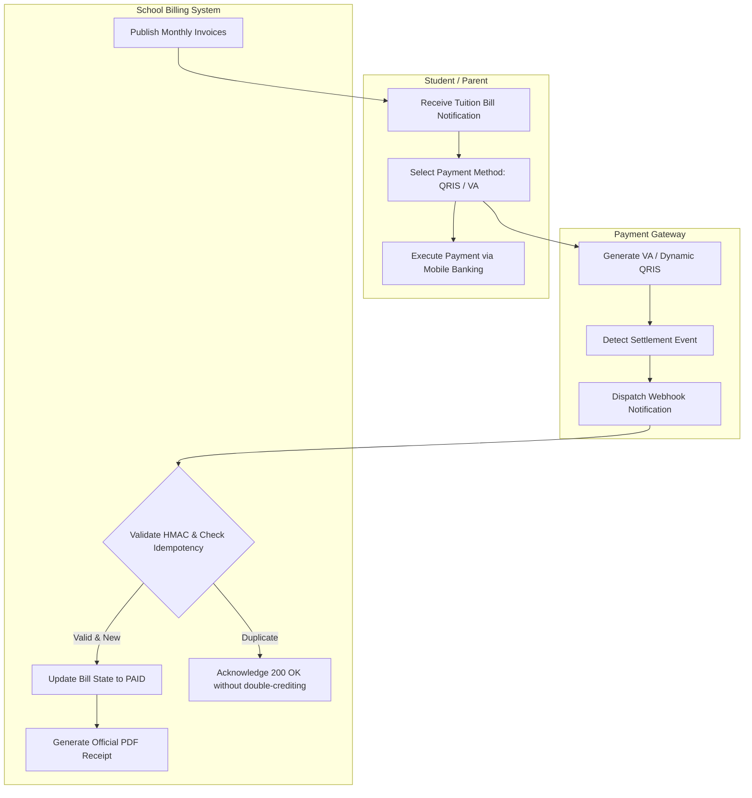

# BPMN Workflow Modeling Patterns

## Standard Mermaid Swimlane Pattern

Use `flowchart TD` or `sequenceDiagram` to illustrate role-segregated flows:

## Modeling Checklist
- Always represent external third-party timeouts.
- Indicate asynchronous webhook retries.
- Show user feedback states when errors occur.
