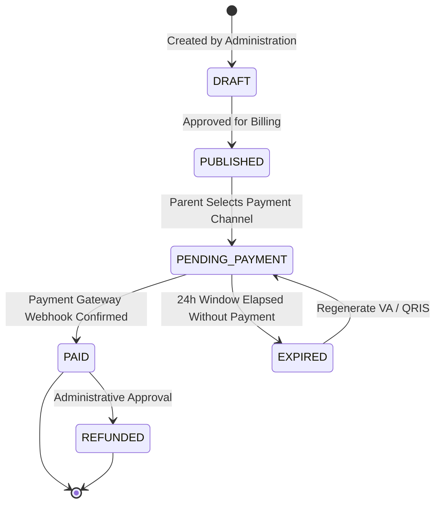

# State Machine Transition Template

## Entity Lifecycle: `Bill` / `Invoice`

## State Transition Rules Matrix

| From State | Event / Trigger | Target State | Guards & Prerequisites | Post-Action / Side Effects |
| :--- | :--- | :--- | :--- | :--- |
| `DRAFT` | `PUBLISH` | `PUBLISHED` | Total amount > 0, items valid | Send notification to parent |
| `PUBLISHED` | `CHECKOUT` | `PENDING_PAYMENT` | Expiration time set | Generate gateway transaction reference |
| `PENDING_PAYMENT` | `WEBHOOK_SUCCESS` | `PAID` | Gateway HMAC valid, amount matches exactly | Unlock student access, issue receipt |
| `PENDING_PAYMENT` | `EXPIRY_JOB` | `EXPIRED` | Current timestamp > expires_at | Invalidate virtual account |
| `PAID` | `PROCESS_REFUND` | `REFUNDED` | Superadmin token + reason | Reverse ledger entry, notify finance |
