# SOP & Panduan Operasional AI-SEOS 2.0 (HOW TO USE)

Selamat datang di panduan operasional **Sakti-Agent — Autonomous AI Software Engineering OS (AI-SEOS)**.
Dokumen ini adalah Standard Operating Procedure (SOP) harian bagi Anda (*Solo Developer / Human Lead*) untuk memimpin 12 agen AI spesialis dalam membangun perangkat lunak *production-grade* secara efisien, bebas halusinasi, dan hemat token (*Context Budget Protocol*).

---

## 1. Menjalankan Dashboard Engineering Command Center

Jalankan dashboard web lokal Next.js 16 (Turbopack):

```bash
make board
# Dashboard berjalan di: http://localhost:3000
```

### Fitur Utama di Dashboard:
1. **Local-First Authentication**:
   - Akun Default: `admin@kasirsakti.local` | Password: `password123` (tersedia tombol 1-klik *"Isi Akun"*).
2. **Kanban Board (Readiness Gates 2.0)**:
   - Memantau pergerakan task melintasi 10 status gerbang kesiapan (*Discovery* $\to$ *Specification* $\to$ *In Review* $\to$ *Ready for Dev* $\to$ *Implementation* $\to$ *Code Review* $\to$ *In QA* $\to$ *Security Check* $\to$ *Release Candidate* $\to$ *Done*).
3. **Spec Drawer & Evidence Hub**:
   - Menampilkan rincian dokumen spesifikasi markdown, checklist kriteria penerimaan, dan **preview visual langsung untuk screenshot / hasil uji pengujian QA** (via `/api/evidence`).
4. **Agents Hub & Documentation Hub**:
   - Direktori 12 spesialis canonical dan penjelajah modul dokumentasi `00-governance` s.d. `10-operations` dengan diagram Mermaid otomatis.

---

## 2. Alur Kerja Harian Solo Developer (End-to-End Workflow)

```mermaid
flowchart TD
    User["1. Human Lead (Anda)\nMisi / Permintaan Fitur"] --> Orc["2. /orchestrator\nKlasifikasi, Scope Lock, Budgeting"]
    Orc --> PM["3. /pm\nPRD, User Stories & Backlog\nStatus: DISCOVERY ➔ SPECIFICATION"]
    PM --> BA["4. /ba\nBPMN Workflow, FSM, Edge Cases\nDocs: use-cases.md, business-rules.md"]
    BA --> Arch["5. /architect\nADR, Skema DB, OpenAPI Contract\nStatus: IN_REVIEW"]
    Arch --> Gate1{"6. Human Approval\n(Human Quality Gate)"}
    Gate1 -- Approved --> Dev["7. /fullstack (atau /frontend /backend)\nVertical Slice Implementation\nStatus: READY_FOR_DEV ➔ IMPLEMENTATION"]
    Dev --> CR["8. /review (Code Reviewer)\nReview Diff, Anti-Race Condition, ADR Check\nStatus: CODE_REVIEW"]
    CR --> QA["9. /qa (Quality Engineer)\nPlaywright E2E, Screenshot Evidence\nStatus: IN_QA"]
    QA --> Sec["10. /security\nSTRIDE Threat Model, SAST Check\nStatus: SECURITY_CHECK"]
    Sec --> DevOps["11. /devops\nDocker Build, CI/CD, Migration Verify\nStatus: READY_FOR_RELEASE"]
    DevOps --> Gate2{"12. Final Human Verification"}
    Gate2 -- Verified --> Done["13. DONE & Production Release\nUpdate Decision Memory & Graph"]
```



---

## 3. Protokol Pemanggilan Agen & Perintah Terminal

Panggil spesialis menggunakan **Slash Command (`/`)** di terminal Antigravity CLI (`agy`):

| Panggilan Slash | Peran Spesialis | Scope Dokumen | Deliverable Wajib & Batasan |
| :--- | :--- | :--- | :--- |
| **`/orc`** | **Orchestrator** | Seluruh repositori & graph | Rencana orkestrasi, scope lock, anggaran token. Dilarang modifikasi kode langsung. |
| **`/pm`** | **Product Manager** | `docs/01-product/`, `03-requirements/` | PRD, User Stories (MoSCoW). **Wajib simpan file dokumen fisik** ke repositori. |
| **`/ba`** | **Business Analyst** | `docs/02-discovery/`, PRD | BPMN process diagrams, FSM transitions, edge case matrix. |
| **`/ui`** | **UI/UX Designer** | `docs/04-ux-design/` | 5 interaction states (Default, Loading, Empty, Error, Success), design tokens. |
| **`/architect`**| **Solution Architect** | `docs/05-architecture/`, `06-api/` | C4 model, ADR di `decision-log.md`, database ERD, OpenAPI specs. |
| **`/fullstack`**| **Fullstack Developer** | Specs fitur & API contracts | Vertical Slice (UI + API + DB migration + tests). Dilarang coding jika status `IN_REVIEW`. |
| **`/frontend`** | **Frontend Developer** | `src/`, `viewer/`, UI specs | React Server Components, responsive layout, form validation. |
| **`/backend`**  | **Backend Developer** | `internal/`, `src/`, DB specs | Domain logic, clean architecture, transactional database persistence. |
| **`/review`**   | **Code Reviewer** | Git diff & ADRs | Laporan review independen (`APPROVED` atau `CHANGES_REQUESTED`). |
| **`/qa`**       | **Quality Engineer** | Acceptance Criteria & evidence | Playwright E2E. **Wajib simpan screenshot bukti uji** ke `docs/08-quality-assurance/evidence/`. |
| **`/security`** | **Security Engineer** | API, DB, config | STRIDE threat model, validasi RBAC/ABAC, OWASP mitigations. |
| **`/devops`**   | **DevOps Engineer** | Dockerfile, CI/CD, scripts | Multi-stage Docker, migration safety, telemetry, health check. |

---

## 4. Panduan Eksekusi Hemat Token (Token Economy)

Gunakan perintah `make` untuk memeriksa repositori sebelum memuat file besar ke context AI:

### A. Cari Simbol Dahulu (*Symbol-First Protocol*)
Jangan memuat file ratusan baris jika hanya butuh satu fungsi atau komponen:
```bash
# Temukan lokasi baris kode spesifik secara instan:
make sakti-inspect SYMBOL=calculateContextBudget
```
*Hasil menampilkan nama file dan nomor baris; AI cukup membaca baris tersebut (Region Read).*

### B. Analisis Risiko & Dependensi Sebelum Refaktor
```bash
make sakti-impact FILE=viewer/src/lib/storage.ts
```
*Hasil mengidentifikasi modul terdampak, file dokumen terkait, serta daftar test suite yang wajib diuji ulang.*

### C. Cek Utilisasi Anggaran Token
```bash
make sakti-context FILES="AGENTS.md scripts/sakti.js"
```
*Memastikan pemuatan konteks berada di bawah batas 16.000 tokens (aman).*

### D. Delegasi Antar Agen Tanpa Scan Ulang (*Context Reuse*)
Setelah agen selesai menganalisis (misal `/ba`), simpan artefak serah terima untuk agen berikutnya:
```bash
make sakti-handoff ROLE=solution-architect SUMMARY="Review routing dan integrasi notifikasi"
```

---

## 5. Alur Pengujian & Pelaporan Hasil QA

Ketika agen `/qa` menguji fitur:
1. Simpan screenshot visual ke folder bukti pengujian:
   `docs/08-quality-assurance/evidence/evidence-[TASK-ID]-[deskripsi].png`
2. Simpan laporan pengujian ke backlog via `make`:
   ```bash
   make task-report ID=TASK-001 RES=passed SUM="Seluruh 3 AC terverifikasi via Playwright" BY="QA Specialist"
   ```
3. Buka tab **Review & Laporan** di Dashboard Viewer: Screenshot UI akan langsung dirender secara visual untuk memudahkan verifikasi Anda (*Human Lead*).

---

## 6. Lembar Pintas Perintah Makefile (Cheatsheet)

| Kategori | Perintah `make` | Fungsi Singkat |
| :--- | :--- | :--- |
| **Dashboard** | `make board` | Jalankan Next.js Web UI di port 3000 |
| **Kesehatan OS**| `make sakti-status` | Cek status AI-SEOS, backlog & 12 agen |
| **Symbol Search**| `make sakti-inspect SYMBOL=nama` | Cari definisi simbol/fungsi tanpa scan file utuh |
| **Impact Check** | `make sakti-impact FILE=path` | Prediksi dampak modul & risiko perubahan |
| **Token Budget** | `make sakti-context FILES="f1 f2"`| Hitung alokasi token terhadap batas 16k tokens |
| **Repo Map** | `make sakti-map DEPTH=2` | Tampilkan hierarki direktori bersih |
| **Task Detail** | `make task-get ID=TASK-XXX` | Baca spesifikasi lengkap task |
| **Ganti Gate** | `make task-status ID=x GATE=ready_for_dev` | Alihkan status task ke gate berikutnya |
| **Laporan QA** | `make task-report ID=x RES=passed SUM="..."` | Simpan hasil pengujian & link evidence |
| **Git Control** | `make git-status`, `make git-branch` | Pantau status working tree & branch aktif |
