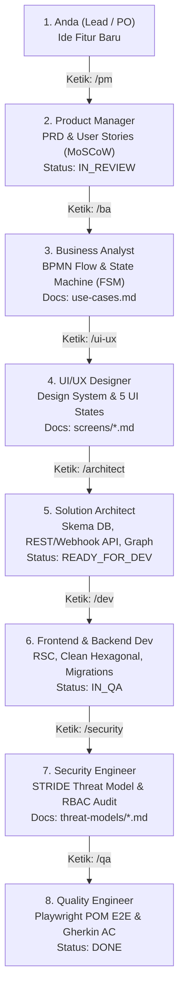

# SOP & Panduan Lengkap Alur Kerja Multi-Agent (HOW TO USE)

Selamat datang di **Agentic Blueprint Starter Kit** — framework rekayasa perangkat lunak modern berbasis **AI Spec-Driven Development**, **Progressive Disclosure**, dan **Codebase Knowledge Graph**.

Dokumen ini adalah panduan standar operasional (SOP) bagaimana Anda (sebagai *Lead Developer / Product Owner*) berkolaborasi secara efisien bersama 8 AI Agent spesialis tanpa pemborosan token (*anti-slop*).

---

## 1. Cara Menjalankan Jira SpecOS Dashboard

Sebelum mulai bekerja, jalankan dashboard web lokal:

```bash
# Di root folder proyek:
pnpm board
# atau
npm run board
```

Buka peramban di: **`http://localhost:3000`**

### Fitur Utama di Dashboard:
1. **Sistem Autentikasi & Akun Default**:
   - **Default Email**: `admin@kasirsakti.local`
   - **Default Password**: `password123`
   - Tombol 1-klik *"Isi Akun"* untuk auto-fill instan tanpa perlu mengetik manual.
   - Pendaftaran akun baru (*Register*) dengan peran tim (Lead Dev, Product Owner, Architect, QA).
   - Profil avatar dengan menu dropdown dan tombol *Logout*.
2. **Kanban Board**: Drag & drop task melintasi 7 tahapan *Readiness Gates*.
3. **Backlog Table**: Tampilan list tabular ala Jira untuk sorting dan filter prioritas.
4. **Documentation Hub**: File explorer 11 modul dokumen (`00-governance` s.d. `10-operations`) dengan rendering otomatis diagram **Mermaid** dan formula.
5. **Knowledge Graph & Scope Navigator**: Visualisasi peta dependensi dan tombol 1-klik *"Copy Context Scope"* untuk prompt hemat token.
6. **Agents Hub**: Katalog 8 peran dan 30+ skill standar industri ([UI-Skills](https://www.ui-skills.com/), [Skills.sh](https://www.skills.sh/), dll.) dengan tombol salin prompt terstruktur.

---

## 2. Audit Alur Kerja 8 Peran Spesialis (End-to-End Workflow)

Setiap fitur baru harus melewati siklus terstruktur agar kode yang dihasilkan 100% sesuai spesifikasi, aman, dan teruji tanpa halusinasi:



---

## 3. Perintah Slash Command Resmi di Antigravity (agy)

Di terminal Antigravity CLI (`agy`), panggil agen menggunakan tanda **garis miring (`/`)**:

| Slash Command | Peran AI Agent | Scope yang Dibaca | Deliverable yang Dihasilkan |
| :--- | :--- | :--- | :--- |
| **`/pm`** | **Product Manager** | `docs/01-product/` | `prd-<fitur>.md`, `user-stories.md`, `risk-register.md` |
| **`/ba`** | **Business Analyst** | PRD fitur terkait | `use-cases.md` (BPMN Mermaid), FSM Matrix, `glossary.md` |
| **`/ui-ux`** | **UI/UX Designer** | PRD & `docs/04-ux-design/` | 5 UI States (Empty/Loading/Error/Partial/Success), Baseline UI |
| **`/architect`**| **Solution Architect** | PRD, BPMN Flow | C4 Diagrams, Skema DB DDL, Kontrak API, Update Knowledge Graph |
| **`/dev`** | **Full-Stack Developer** | Scoped API & UI Specs | Komponen React Server, Service Domain, Database Migrations |
| **`/security`** | **Security Engineer** | API Contracts & DB | Analisis STRIDE, Validasi HMAC Webhook, RBAC Matrix |
| **`/qa`** | **Quality Engineer** | Acceptance Criteria | Otomasi Playwright E2E (POM), Contract Tests, Checklist AC |

> [!TIP]
> **Cara Memanggil Agen di Antigravity CLI (`agy`):**
> 1. **Perintah Slash `/pm` (Skill Execution - Paling Direkomendasikan)**:
>    Ketik `/pm [instruksi]` untuk memuat skill Product Manager langsung ke memori kerja Antigravity (contoh: `/pm buatkan PRD fitur A`).
> 2. **Teks Alami `@pm`**:
>    Jika Anda mengetik `@pm buatin fitur A`, sistem AI otomatis mendeteksi peran PM dan mengeksekusi instruksi dengan batasan Product Manager.
> 3. **File Mention `@agents/...`**:
>    Jika ingin melampirkan file instruksi peran secara eksplisit, ketik `@agents/` lalu pilih `AGENT.md` peran terkait (contoh: `@agents/pm/AGENT.md tolong review scope`).

---

## 4. Panduan Praktis & Contoh Prompt Langkah-demi-Langkah

Gunakan studi kasus nyata: **Fitur Pembayaran SPP Sekolah (`FEAT-002-school-payment`)**:

### Langkah 1: Merumuskan PRD & User Stories (`/pm`)
Ketik di terminal:
```bash
/pm Saya ingin membuat fitur pembayaran SPP sekolah (FEAT-002). Tolong susun PRD lengkap di docs/03-requirements/features/FEAT-002-school-payment/ berisi problem statement, target persona orang tua & TU, scope in/out, user stories (MoSCoW), dan risk register. Status awal IN_REVIEW.
```

### Langkah 2: Memetakan Alur Proses & State Machine (`/ba`)
Ketik di terminal:
```bash
/ba Dari PRD FEAT-002, tolong buatkan diagram alur interaksi multi-aktor (Orang Tua, Portal Siswa, Core Billing, Payment Gateway) menggunakan Mermaid sequence diagram di use-cases.md, beserta tabel Finite State Machine (FSM) untuk siklus tagihan (DRAFT -> PUBLISHED -> PENDING_PAYMENT -> PAID).
```

### Langkah 3: Menentukan Standar Visual & 5 State UI (`/ui-ux`)
Ketik di terminal:
```bash
/ui-ux Rancang spesifikasi antarmuka kartu tagihan siswa dan modal pembayaran QRIS untuk FEAT-002. Terapkan aturan baseline-ui (angka tabular-nums, animasi <200ms, touch target 44px) dan sertakan 5 state: Ideal, Loading skeleton, Empty, Error banner, dan Expired state.
```

### Langkah 4: Merancang Database & Kontrak API (`/architect`)
Ketik di terminal:
```bash
/architect Rancang skema database PostgreSQL (tabel bills, payment_transactions, receipts) di docs/05-architecture/schemas/billing-schema.md dan kontrak REST API serta Webhook receiver di docs/06-api/. Daftarkan relasi node baru ini ke data/knowledge-graph.json dan ubah status fitur menjadi READY_FOR_DEV.
```

### Langkah 5: Implementasi Kode Aplikasi (`/dev`)
Ketik di terminal:
```bash
/dev Implementasikan komponen antarmuka kartu tagihan siswa dan endpoint webhook settlement untuk FEAT-002. Rujuk hanya pada file yang tercantum dalam knowledge graph scope. Terapkan Clean Architecture dan proteksi idempotency key.
```

### Langkah 6: Audit Keamanan STRIDE (`/security`)
Ketik di terminal:
```bash
/security Lakukan audit STRIDE threat modeling pada endpoint /api/webhooks/payment dan verifikasi mekanisme HMAC-SHA256 signature serta pencegahan vulnerability IDOR/BOLA pada pencarian tagihan siswa.
```

### Langkah 7: Verifikasi Acceptance Criteria & E2E Test (`/qa`)
Ketik di terminal:
```bash
/qa Verifikasi kriteria penerimaan Gherkin FEAT-002. Buatkan skrip otomasi Playwright menggunakan Page Object Model (POM) yang menguji alur pembayaran QRIS hingga lunas serta simulasi penolakan webhook palsu tanpa signature otentik.
```

---

## 5. Cara Menghemat Token (Token Optimization SOP)

Sebelum meminta agen AI melakukan refactor atau implementasi besar, **jangan memindai seluruh folder proyek**. Lakukan query graph terlebih dahulu:

```bash
# 1. Dapatkan daftar file minimal yang terkait dengan fitur:
node scripts/graph-lookup.js --feature FEAT-002-school-payment

# 2. Atau klik tombol "Copy Context Scope" di tab Knowledge Graph pada Web UI.
```

Hasilnya akan memberikan daftar presisi (~4 file spesifik):
- `[DOCUMENT]` PRD & Use Cases
- `[DATA_MODEL]` Billing Relational Schema
- `[API_ENDPOINT]` REST & Webhook Contracts
- `[TEST_SUITE]` Playwright E2E Journey

Dengan hanya memuat file-file tersebut, Anda menghemat **hingga 85% konsumsi token** per sesi chat!

---

## 6. Cara Mengkloning Starter Kit Ini ke Proyek Baru

Untuk menggunakan arsitektur ini di proyek baru Anda:

1. **Salin Folder Starter Kit:**
   ```bash
   cp -r /home/revwmt/Documents/learning/agentic-starter-kit /path/ke/proyek-baru
   cd /path/ke/proyek-baru
   ```
2. **Bersihkan Sample Data (Opsional):**
   - Hapus atau sesuaikan folder contoh `docs/03-requirements/features/FEAT-002-school-payment/`.
   - Buka `data/backlog.json` dan ganti nama proyek Anda di field `"project_name"`.
3. **Jalankan Dashboard:**
   ```bash
   pnpm install
   pnpm board
   ```
4. **Mulai Bekerja:** Panggil `/pm` untuk merancang fitur pertama Anda!
