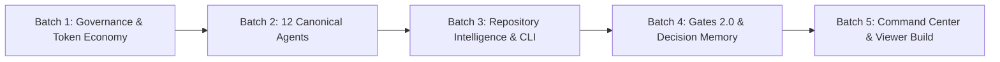

# Dokumentasi Implementasi: Sakti-Agent AI-SEOS 2.0

Dokumen ini menjelaskan seluruh fitur, arsitektur, modul kecerdasan, dan standarisasi baru yang telah diimplementasikan ke dalam **Sakti-Agent** berdasarkan blueprint [sumaryai.md](file:///home/revwmt/Documents/learning/agentic-starter-kit/sumaryai.md).

Proyek ini telah berevolusi dari sekadar AI Starter Kit menjadi **Autonomous AI Software Engineering Operating System (AI-SEOS)** untuk solo-developer dengan filosofi:

> **"One Developer. One Engineering System. Multiple AI Specialists. One Source of Truth. Production-Grade Software."**

---

## 1. Rangkuman Batch Implementasi

Transformasi telah diselesaikan melalui 5 tahapan bertahap (*batches*):



---

## 2. Rincian Modul & Fitur yang Baru Diimplementasikan

### A. Konstitusi Tata Kelola & Kebijakan Hemat Token (Batch 1)
1. **Master Guidelines Baru ([`AGENTS.md`](file:///home/revwmt/Documents/learning/agentic-starter-kit/AGENTS.md))**:
   - Menetapkan aturan **7-Level Progressive Disclosure**:
     - `Level 0`: Pahami Inti Tugas (Task Classification & Scope Lock)
     - `Level 1`: Muat 1 Skill Relevan (Skill Activation)
     - `Level 2`: Inspeksi Repository Map & Graph
     - `Level 3`: Cari Simbol Relevan (*Symbol First*)
     - `Level 4`: Baca Region Kode Spesifik (*Region Read*)
     - `Level 5`: Hubungkan Dependencies, Specs & Test Cases
     - `Level 6`: Deep Investigation (Hanya jika parameter `--deep` aktif)
2. **Token Economy Policy ([`.agents/policies/token-economy.yaml`](file:///home/revwmt/Documents/learning/agentic-starter-kit/.agents/policies/token-economy.yaml))**:
   - Default budget: **16.000 tokens** (Maksimal: 32.000 tokens).
   - Ambang kompresi otomatis: **80% utilisasi**.
   - Search Limits: Maksimal 20 file dan 10 match per file.
   - Ignored Paths: `node_modules/**`, `.git/**`, `.next/**`, `dist/**`, `build/**`, `coverage/**`, `vendor/**`, `tmp/**`, `logs/**`, `*.lock`, `*.min.js`.
3. **Agent Permission Boundaries ([`.agents/policies/agent-boundaries.yaml`](file:///home/revwmt/Documents/learning/agentic-starter-kit/.agents/policies/agent-boundaries.yaml))**:
   - Matriks tegas hak akses baca dan tulis file antar peran spesialis untuk mencegah AI merusak source code aplikasi di luar wewenangnya.
4. **Context Persistence Folder (`.context/`)**:
   - Direktori khusus untuk menyimpan artefak ringkasan konteks antar agen (*Context Reuse*) agar agen downstream tidak memindai ulang seluruh kode repositori.

---

### B. Ekosistem 12 Canonical AI Specialists (Batch 2)
Penambahan dan standardisasi peran spesialis lengkap dengan file panduan `AGENT.md`, `SKILL.md`, serta symlink shortcuts:

| Canonical Role ID | Shortcut (`/`) | Peran & Batasan Tanggung Jawab Utama |
| :--- | :---: | :--- |
| **Orchestrator** | `/orchestrator` / `/orc` | Pusat kendali, klasifikasi kompleksitas tugas, context compiler, dan delegasi tanpa memanggil semua agen sekaligus. |
| **Product Manager (PM)** | `/pm` | Visi produk, PRD, user stories, dan MoSCoW prioritization. **Wajib menyimpan dokumen fisik** ke `docs/01-product/` atau `docs/03-requirements/`. |
| **Business Analyst (BA)** | `/ba` | Pemodelan proses bisnis (BPMN), state machine transitions, edge cases, dan business rules. |
| **UI/UX Designer** | `/ui` | Design system, visual hierarchy, interaction states, dan kepatuhan WCAG AA. |
| **Solution Architect** | `/architect` | C4 Model diagrams, Architecture Decision Records (ADR), OpenAPI contracts, dan skema database. |
| **Fullstack Developer** | `/fullstack` | Eksekusi fitur secara vertikal (*Vertical Slice Architecture*): UI + API + DB Migrasi + Unit Test. |
| **Frontend Developer** | `/frontend` / `/dev` | Client UI, React Server Components (RSC), responsive layout, client-side state. |
| **Backend Developer** | `/backend` / `/dev` | Domain logic, Clean Architecture (Ports & Adapters), persistensi transaksi ACID, resiliensi API. |
| **Code Reviewer** | `/review` | Reviewer independen untuk mendeteksi pelanggaran arsitektur, *race condition*, dan keamanan sebelum tahap QA. |
| **Quality Engineer (QE)** | `/qa` | Playwright E2E, pengujian Gherkin. **Wajib melampirkan screenshot & bukti uji** ke `docs/08-quality-assurance/evidence/`. |
| **Security Engineer** | `/security` | STRIDE threat modeling, mitigasi OWASP Top 10, SAST/DAST, kebijakan RBAC/ABAC. |
| **DevOps Engineer** | `/devops` | Docker multi-stage build, otomasi CI/CD, verifikasi backward-compatibility migrasi database, dan kesiapan rilis. |

---

### C. Repository Intelligence & Sakti Unified CLI (Batch 3)
Menghadirkan rangkaian alat bantu kecerdasan kode pada [`scripts/sakti.js`](file:///home/revwmt/Documents/learning/agentic-starter-kit/scripts/sakti.js) (dapat dipanggil via `pnpm sakti` atau `npm run sakti`):

1. **`sakti status`**:
   - Menampilkan ringkasan kesehatan sistem, backlog aktif per status, daftar spesialis, dan konfigurasi token policy.
2. **`sakti inspect <symbol>`** ([`intelligence/repository-indexer/indexer.js`](file:///home/revwmt/Documents/learning/agentic-starter-kit/intelligence/repository-indexer/indexer.js)):
   - Protokol *Symbol-First*: Menemukan deklarasi fungsi, antarmuka, atau komponen secara presisi beserta nomor baris tanpa membaca seluruh isi file.
3. **`sakti impact <file/module>`** ([`intelligence/impact-analyzer/impact.js`](file:///home/revwmt/Documents/learning/agentic-starter-kit/intelligence/impact-analyzer/impact.js)):
   - Memetakan dependensi langsung & tidak langsung dari modul yang diubah, menentukan test suite yang wajib dijalankan kembali (*Regression Guard*), dan menaksir tingkat risiko perubahan (`LOW`, `MEDIUM`, `HIGH`).
4. **`sakti context [files...]`** ([`engine/context-engine/budget.js`](file:///home/revwmt/Documents/learning/agentic-starter-kit/engine/context-engine/budget.js)):
   - Menghitung estimasi konsumsi token untuk file-file yang aktif dan memberikan peringatan dini (*Context Pressure*) jika melebihi 80% dari batas 16k tokens.
5. **`sakti handoff <target-role> [summary]`**:
   - Membuat artefak serah terima tugas terstruktur di folder `.context/` sehingga agen berikutnya dapat langsung bekerja dari ringkasan tersebut (*Context Reuse*).
6. **`sakti repo-map [depth]`**:
   - Menghasilkan visualisasi pohon direktori yang bersih tanpa menyertakan folder dependensi atau cache.

---

### D. Readiness Gates 2.0 & Engineering Memory (Batch 4)
1. **Siklus 10 Tahapan Kesiapan Validasi ([`data/backlog.json`](file:///home/revwmt/Documents/learning/agentic-starter-kit/data/backlog.json))**:
   ```text
   [DISCOVERY] ──> [SPECIFICATION] ──> [IN_REVIEW] ──(Human Approval)──> [READY_FOR_DEV]
         │
         └──> [IMPLEMENTATION] ──> [CODE_REVIEW] ──> [IN_QA] ──> [SECURITY_CHECK] ──> [READY_FOR_RELEASE] ──> [DONE]
   ```
2. **Pembaruan Task CLI State Machine ([`scripts/task.js`](file:///home/revwmt/Documents/learning/agentic-starter-kit/scripts/task.js))**:
   - Memvalidasi 10 status resmi di atas dan mendukung pemetaan alias otomatis (*backward compatibility*):
     - `backlog` $\to$ `discovery`
     - `spec_drafting` $\to$ `specification`
     - `in_progress` $\to$ `implementation`
3. **Pencatatan Keputusan Rekayasa ([`docs/00-governance/decision-log.md`](file:///home/revwmt/Documents/learning/agentic-starter-kit/docs/00-governance/decision-log.md))**:
   - Mencatat keputusan **DEC-008**: Penetapan arsitektur universal Sakti-Agent AI-SEOS 2.0 dengan 12 spesialis canonical dan Readiness Gates 2.0.

---

### E. Integrasi Command Center Dashboard & Viewer Hub (Batch 5)
1. **Dukungan Status & Role pada Viewer ([`viewer/src/lib/storage.ts`](file:///home/revwmt/Documents/learning/agentic-starter-kit/viewer/src/lib/storage.ts))**:
   - Mendefinisikan tipe `TaskStatus` lengkap yang mencakup seluruh status gates baru.
   - Registrasi 12 peran canonical lengkap dengan ikon dan penanganan deduplikasi alias.
2. **Dropdown Penugasan Agen ([`SpecDrawer.tsx`](file:///home/revwmt/Documents/learning/agentic-starter-kit/viewer/src/components/SpecDrawer.tsx) & [`NewTaskModal.tsx`](file:///home/revwmt/Documents/learning/agentic-starter-kit/viewer/src/components/NewTaskModal.tsx))**:
   - Dropdown penugasan agen telah memuat seluruh 12 spesialis (Orchestrator, PM, BA, UI/UX, Architect, Fullstack, Frontend, Backend, Code Reviewer, Quality Engineer, Security Engineer, DevOps Engineer).
3. **Dedicated Evidence API & Visual Preview**:
   - Endpoint `/api/evidence?path=...` menyajikan file screenshot UI (`.png`, `.jpg`, `.webp`) dan file log secara aman tanpa directory traversal.
   - Komponen Markdown Viewer menampilkan gambar hasil uji QA secara visual dan responsif.
4. **Verifikasi Build**:
   - Build Next.js (`npm run build`) sukses 100% tanpa error TypeScript maupun kompilasi route.

---

## 3. Cara Menggunakan Fitur Baru

```bash
# 1. Menjalankan Dashboard Kanban & Docs Hub
pnpm board         # Dashboard berjalan di http://localhost:3000

# 2. Perintah CLI Sakti-Agent
npm run sakti -- status                    # Cek status kesehatan OS dan backlog
npm run sakti -- inspect <symbol>          # Cari definisi fungsi/simbol spesifik
npm run sakti -- impact <file-path>        # Cek modul & test terdampak perubahan
npm run sakti -- context [files...]        # Hitung alokasi dan sisa token budget
npm run sakti -- handoff <role> "Summary"  # Buat artefak serah terima di .context/
npm run sakti -- repo-map 2                # Tampilkan pohon direktori bersih

# 3. Manajemen Task Lifecycle (Readiness Gates 2.0)
node scripts/task.js list                  # Menampilkan semua task
node scripts/task.js get <TASK-ID>         # Membaca rincian spesifikasi task
node scripts/task.js set-status <ID> <GATE> # Pindahkan task ke gate berikutnya
node scripts/task.js check-ac <ID> <AC-ID> # Centang kriteria penerimaan
node scripts/task.js report <ID> passed "Ringkasan" "Tester" # Simpan laporan QA
```

---

## 4. Status Git & Branch

Seluruh pekerjaan telah terisolasi rapi dan siap di-merge:
- **Branch Aktif**: `feat/batch-1-governance-token-economy`
- **Total Commit**: 5 commit bertahap (Batch 1 s.d. Batch 5)
- **Status Working Tree**: Bersih (`working tree clean`).
