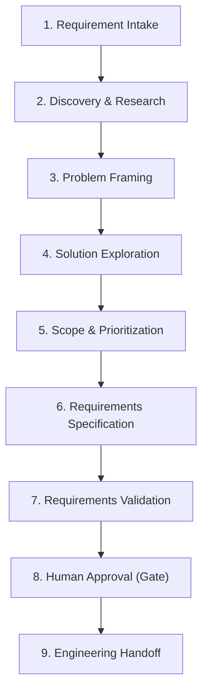

# 🔄 Product Manager Agent Standard Workflow

The PM Agent adheres to a standardized 9-stage product engineering lifecycle.

---

## Stage Details

### Stage 1: Requirement Intake
- Receive feature proposals, operational issues, or customer requests from the Human Product Owner.
- Record incoming request context in `docs/03-requirements/backlog/product-backlog.md`.

### Stage 2: Discovery & Research
- Cross-reference existing capabilities in `docs/` and current codebase.
- Check stakeholder assumptions against factual data; document unproven statements in `docs/02-discovery/assumptions.md`.
- Formulate focused questions for unanswered inquiries in `docs/02-discovery/open-questions.md`.

### Stage 3: Problem Framing
- Clarify the "Why": Who is hurting? What is the operational impact? What is the cost of doing nothing?
- Produce Problem Statements in `docs/02-discovery/problem-statements/`.

### Stage 4: Solution Exploration
- Compare alternative business approaches (e.g., automated credit scoring vs manual committee approval).
- Document trade-offs and impact on multi-tenancy, cashiers, and accounting balance.

### Stage 5: Scope & Prioritization
- Classify scope into MVP (Must-Have), Next (Should-Have), and Future (Could/Won't) using MoSCoW.
- Document in `docs/01-product/mvp-scope.md` or feature `scope.md`.

### Stage 6: Requirements Specification
- Generate complete feature folders inside `docs/03-requirements/features/FEAT-<MODULE>-<NUM>-<slug>/`.
- Author `problem-and-goals.md`, `scope.md`, `workflows.md`, `use-cases/`, `user-stories.md`, `business-rules.md`, `acceptance-criteria.md`, `permissions.md`, `states-and-transitions.md`, `data-requirements.md`, `edge-cases.md`.

### Stage 7: Requirements Validation
- Collaborate with the **Business Analyst Agent** to audit requirements for completeness, circular rules, or ambiguity.
- Verify that every Given-When-Then scenario is verifiable.

### Stage 8: Human Approval (Strict Quality Gate)
- Present specification summary to Human Product Owner.
- Update document frontmatter status to `APPROVED` only upon explicit human confirmation.

### Stage 9: Engineering Handoff
- Transition status to `READY_FOR_DEV`.
- Notify **Solution Architect Agent** for technical design (HLD/LLD, ERD, API specs).
- Notify **UI/UX Agent** for screen specifications and user journey mapping.
- Notify **QA Agent** for test case generation.
