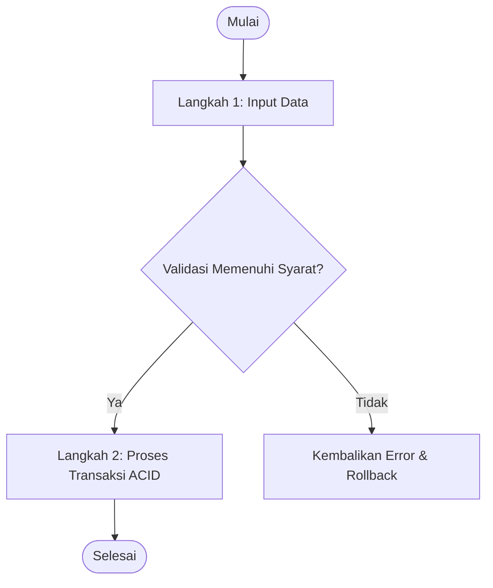
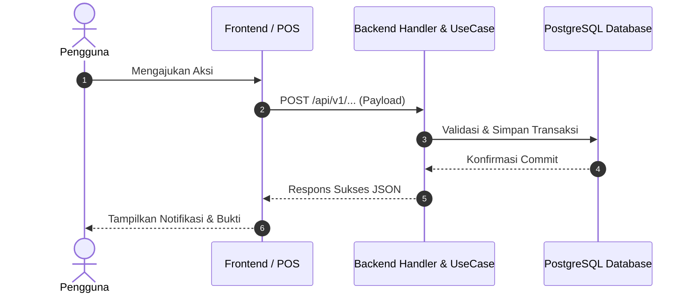

# Alur Kerja & Diagram Proses (Workflows): [Nama Fitur]

Dokumen ini memvisualisasikan alur kerja interaksi antar aktor, sistem frontend, backend, dan database.

---

## 1. Diagram Alur Proses (Process Flowchart)

## 2. Diagram Urutan (Sequence Diagram)

