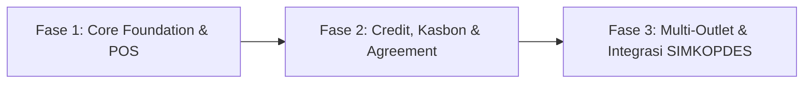

# 🎯 Strategi Produk — KasirSakti

## 1. Posisi Nilai Strategis (Value Proposition)
KasirSakti membedakan dirinya dari aplikasi kasir generik di pasaran melalui tiga pilar keunggulan:
1. **Integritas Finansial Mendalam (Audit-Grade Accounting)**: Tidak sekadar mencatat riwayat penjualan, tetapi secara native menjalankan mesin *double-entry bookkeeping* di balik layar untuk setiap mutasi kas, persediaan, dan hutang/piutang.
2. **Kepatuhan & Pengendalian Kredit Kasbon Koperasi**: Dirancang khusus untuk mengakomodasi realitas bisnis koperasi pedesaan dan toko kelontong di mana pembelian barang tempo (kasbon petani/anggota pascapanen) mendominasi, dengan penegakan credit limit dan dokumen perjanjian tertulis.
3. **Mekanisme Anti-Kecurangan Kasir (Anti-Fraud First)**: Penegakan *blind cash shift closing*, pencatatan *petty cash* laci, dan rekonsiliasi matematis independen.

---

## 2. Strategi Penerapan Bertahap (Phased Rollout)

### Fase 1: Fondasi Kasir & Inventori Aman (Existing Backend Ready)
- Pembayaran tunai/non-tunai di kasir.
- Shift kasir dengan blind closing.
- Pengelolaan multi-unit dan pemotongan stok otomatis.
- Otomatisasi jurnal dasar penjualan dan HPP.

### Fase 2: Manajemen Kredit Kasbon & Dokumen Perjanjian
- Penegakan credit limit per anggota/pelanggan.
- Otomatisasi pembuatan dokumen perjanjian untuk transaksi di atas batas threshold (> Rp100.000).
- Penjadwalan pembayaran cicilan fleksibel (bulanan maupun musiman panen).

### Fase 3: Skalabilitas Multi-Cabang & Ekosistem Terbuka
- Sinkronisasi asinkron ke sistem induk koperasi pemerintah (SIMKOPDES).
- Konsolidasi neraca keuangan multi-cabang.
- Modul HRIS dan payroll otomatis terintegrasi ke jurnal akuntansi.
