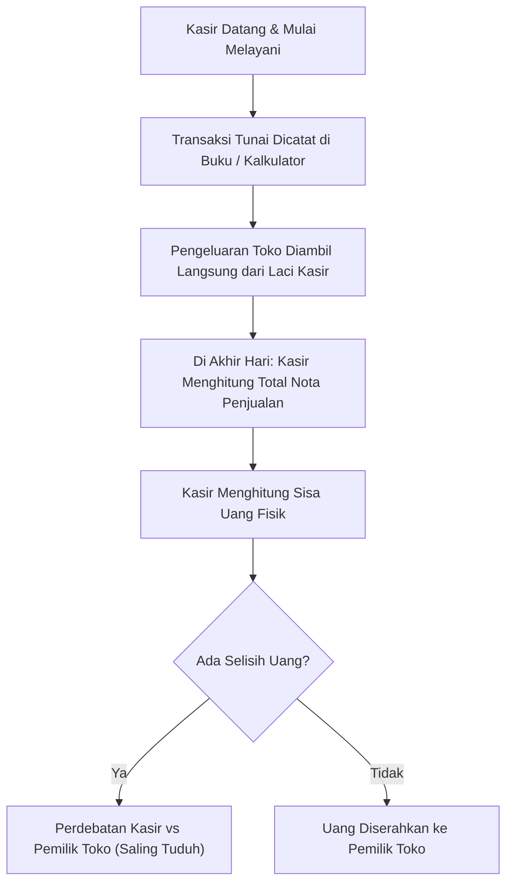
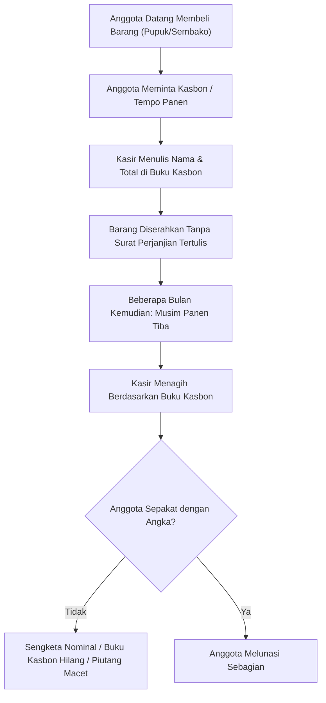

# 🕰️ Proses Bisnis Saat Ini (AS-IS Process)

Dokumen ini memetakan kondisi operasional aktual yang berjalan di sebagian besar unit usaha koperasi desa dan toko ritel konvensional sebelum mengadopsi KasirSakti.

---

## 1. Alur Transaksi Kasir & Kas Laci Konvensional

### Masalah pada Alur Ini:
1. Tidak ada rekonsiliasi formal modal awal kasir.
2. Kasir mengetahui total penjualan sistem sebelum menghitung uang fisik sehingga rawan manipulasi.
3. Nota pengeluaran kas kecil (*petty cash*) tercecer atau tidak dicatat sama sekali.

---

## 2. Alur Pembelian Tempo (Kasbon) Manual

### Masalah pada Alur Ini:
1. Ketiadaan batas plafon hutang (*credit limit*).
2. Ketiadaan dokumen perjanjian yang dapat dipertanggungjawabkan secara hukum perdata.
3. Sering terjadi pembengkakan saldo piutang tak terkendali.
