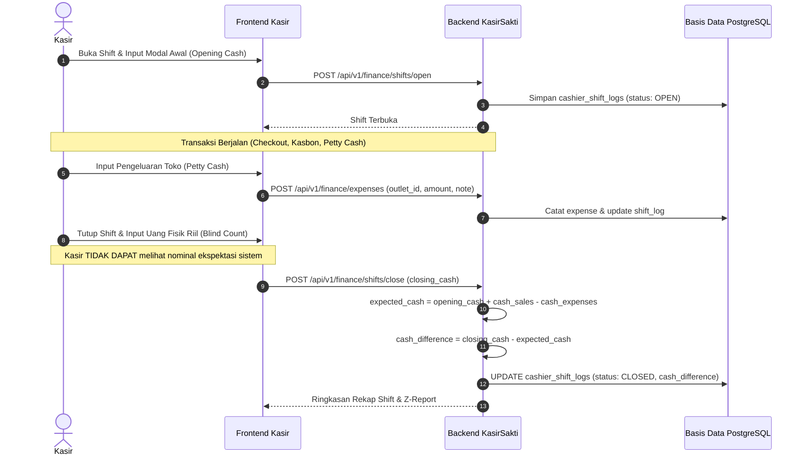
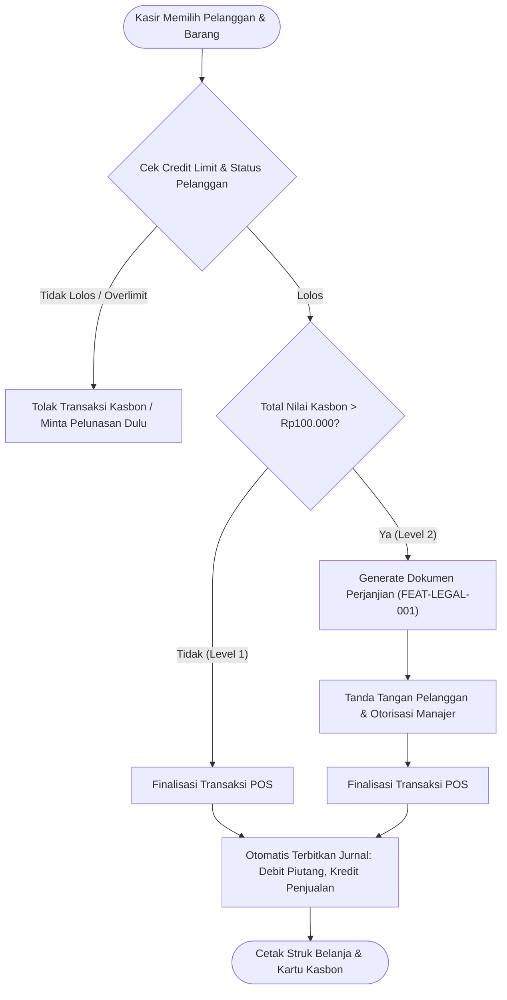

# 🚀 Proses Bisnis Masa Depan (TO-BE Process) — KasirSakti

Dokumen ini memetakan alur kerja operasional baru yang terintegrasi, aman, dan dapat diaudit menggunakan platform KasirSakti.

---

## 1. Alur Shift Kasir & Rekonsiliasi Blind Closing

---

## 2. Alur Transaksi Kasbon & Penegakan Perjanjian

