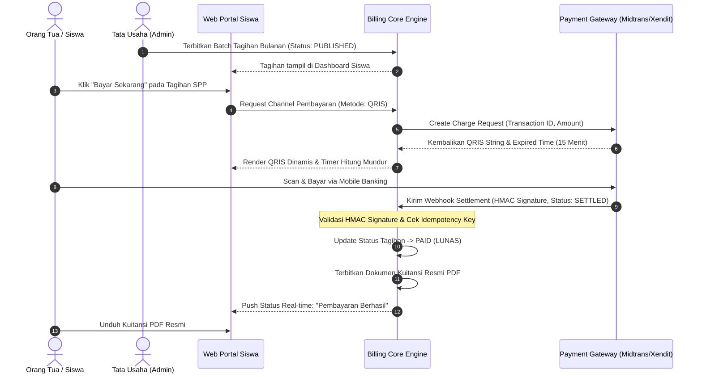

# Use Cases & Process Workflow: Sistem Pembayaran Sekolah

## 1. End-to-End BPMN Workflow Diagram

## 2. Rincian Use Cases

### UC-01: Penerbitan Tagihan Siswa (Generate Bills)
- **Aktor**: Staf Tata Usaha.
- **Prekondisi**: Data siswa aktif dan konfigurasi tarif SPP tahun ajaran aktif telah terdaftar.
- **Main Flow**:
  1. Admin memilih rombel kelas (misal: "Kelas X-IPA 1").
  2. Admin memilih jenis biaya ("SPP Bulan November 2026", Rp 500.000).
  3. Admin menetapkan tanggal jatuh tempo (10 November 2026).
  4. Sistem memvalidasi dan membuat record tagihan status `PUBLISHED`.
- **Alternate Flow**: Jika siswa mendapatkan beasiswa 100%, sistem menghasilkan tagihan Rp 0 berstatus otomatis `PAID`.

### UC-02: Pembayaran Mandiri via Virtual Account / QRIS
- **Aktor**: Orang Tua / Siswa.
- **Prekondisi**: Siswa login dan memiliki tagihan berstatus `PUBLISHED` atau `PENDING_PAYMENT`.
- **Main Flow**:
  1. Orang tua membuka menu Tagihan Saya.
  2. Orang tua menekan tombol "Bayar" dan memilih channel pembayaran (QRIS atau VA Bank).
  3. Sistem memanggil gateway API untuk membuat dynamic billing code.
  4. Layar menampilkan nomor VA / gambar QR code beserta nominal tagihan presisi.
  5. Pengguna menyelesaikan transfer dalam waktu batas (QRIS: 15 menit, VA: 24 jam).

### UC-03: Rekonsiliasi Webhook & Penerbitan Kuitansi
- **Aktor**: Payment Gateway (Sistem).
- **Prekondisi**: Server menerima HTTP POST di `/api/webhooks/payment`.
- **Main Flow**:
  1. Core service mengekstrak signature header `X-Signature`.
  2. Core service menghitung HMAC-SHA256 dari payload menggunakan secret key.
  3. Jika valid dan event = `settlement`, sistem mencari record transaksi.
  4. Memperbarui status tagihan menjadi `PAID` dalam transaksi database ACID.
  5. Mengembalikan response `200 OK` ke gateway.
- **Exception Flow**:
  - Signature tidak cocok: Kembalikan `401 Unauthorized` dan catat log insiden keamanan.
  - Event duplikat (Idempotency): Kembalikan `200 OK` tanpa menjalankan pembaruan ganda.
