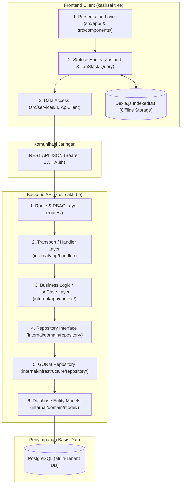

# 🏛️ High-Level Design (HLD) — Full-Stack KasirSakti Architecture

Dokumen ini menjelaskan arsitektur menyeluruh sistem KasirSakti, mencakup layer Frontend (Next.js 16 3-Layer) dan Backend (Golang Strict Clean Architecture).

---

## 1. Arsitektur Menyeluruh (End-to-End Architecture)

---

## 2. Lapisan Frontend (`kasirsakti-fe/`)
1. **Presentation Layer (`src/app/`, `src/components/`)**:
   - Komponen React 19 Client Components (`'use client'`).
   - Menerapkan KasirSakti Design System (Tailwind v4, `#0052FF`, `rounded-full`, dark mode).
   - Dilarang memanggil Axios secara langsung.
2. **State & Hooks Layer (`src/store/`, `src/hooks/`)**:
   - Zustand: Mengelola state UI interaktif, status modal, form input, dan keranjang POS.
   - TanStack React Query: Mengelola caching data server, background refetch, dan invalidasi otomatis.
3. **Data Access Layer (`src/services/`, `src/lib/api.ts`)**:
   - Menyelubungi seluruh panggilan HTTP REST dengan interceptor token JWT Bearer otomatis.
4. **Offline Resilience Layer (`src/utils/db.ts`)**:
   - Menyimpan master produk dan antrean transaksi lokal saat jaringan internet terputus.

---

## 3. Lapisan Backend (`kasirsakti-be/`)
1. **Route Layer**: Registrasi URL endpoint, pengikatan role otorisasi via middleware `auth.MyAuth(...)`.
2. **Handler Layer**: Binding JSON DTO dan response formatting via `library/helper/response.go`. Tidak ada query SQL.
3. **UseCase Layer**: Aturan bisnis, validasi stok, penegakan credit limit, dan transaksi atomik `TransactionManager`.
4. **Repository Layer**: Abstraksi interface dan implementasi GORM SQL yang selalu menyertakan `merchant_id`.
