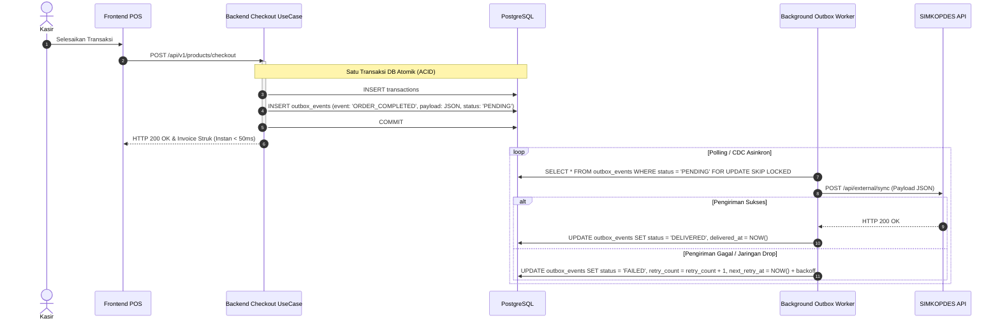

# 🌐 Desain Pola Integrasi SIMKOPDES (Transactional Outbox)

Dokumen ini menjelaskan pola arsitektur *Transactional Outbox* yang disiapkan untuk mengisolasi kegagalan sinkronisasi pihak ketiga ke platform SIMKOPDES.

---

## 1. Masalah yang Diselesaikan
Jika checkout kasir memanggil API eksternal SIMKOPDES secara langsung (*synchronous HTTP call*):
- Jika koneksi internet drop atau server SIMKOPDES down, pelanggan di kasir tidak bisa membayar.
- Latensi checkout menjadi lambat (&gt; 2 detik).

---

## 2. Solusi: Transactional Outbox Pattern

---

## 3. Status Teknis
Kontrak skema JSON dan URL endpoint SIMKOPDES menunggu rilis resmi: `[TODO: PENDING_OFFICIAL_API_DOCS]`.
Tabel `outbox_events` siap diimplementasikan tanpa mengubah layer domain POS.
