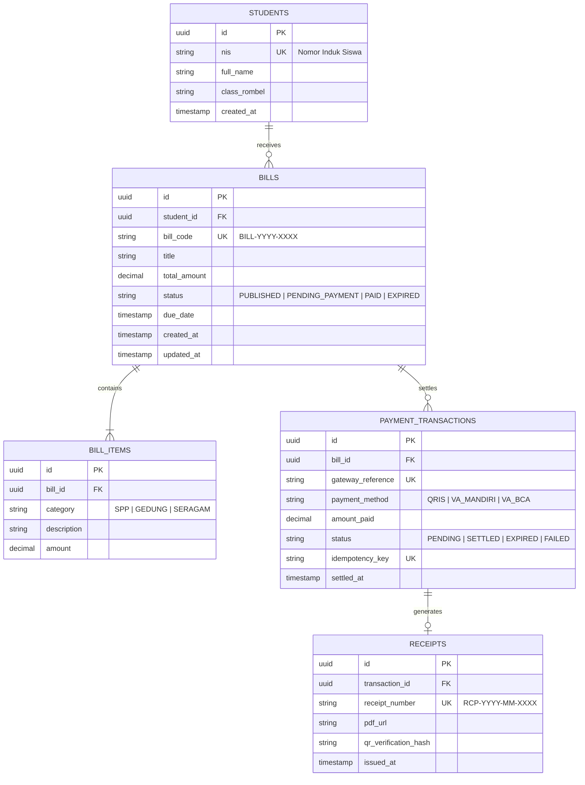

# Database Schema: Billing & Invoicing (School Tuition)

## Entity Relationship Overview



## SQL DDL Reference (PostgreSQL)

```sql
CREATE TABLE bills (
    id UUID PRIMARY KEY DEFAULT gen_random_uuid(),
    student_id UUID NOT NULL REFERENCES students(id) ON DELETE RESTRICT,
    bill_code VARCHAR(32) NOT NULL UNIQUE,
    title VARCHAR(120) NOT NULL,
    total_amount NUMERIC(14, 2) NOT NULL CHECK (total_amount >= 0),
    status VARCHAR(24) NOT NULL DEFAULT 'PUBLISHED' CHECK (status IN ('DRAFT', 'PUBLISHED', 'PENDING_PAYMENT', 'PAID', 'EXPIRED')),
    due_date TIMESTAMPTZ NOT NULL,
    created_at TIMESTAMPTZ NOT NULL DEFAULT NOW(),
    updated_at TIMESTAMPTZ NOT NULL DEFAULT NOW()
);

CREATE INDEX idx_bills_student_status ON bills(student_id, status);
CREATE INDEX idx_bills_due_date ON bills(due_date);

CREATE TABLE payment_transactions (
    id UUID PRIMARY KEY DEFAULT gen_random_uuid(),
    bill_id UUID NOT NULL REFERENCES bills(id) ON DELETE RESTRICT,
    gateway_reference VARCHAR(64) NOT NULL UNIQUE,
    payment_method VARCHAR(24) NOT NULL,
    amount_paid NUMERIC(14, 2) NOT NULL,
    status VARCHAR(24) NOT NULL DEFAULT 'PENDING' CHECK (status IN ('PENDING', 'SETTLED', 'EXPIRED', 'FAILED')),
    idempotency_key VARCHAR(128) NOT NULL UNIQUE,
    settled_at TIMESTAMPTZ NULL,
    created_at TIMESTAMPTZ NOT NULL DEFAULT NOW()
);

CREATE INDEX idx_transactions_bill_id ON payment_transactions(bill_id);
```
