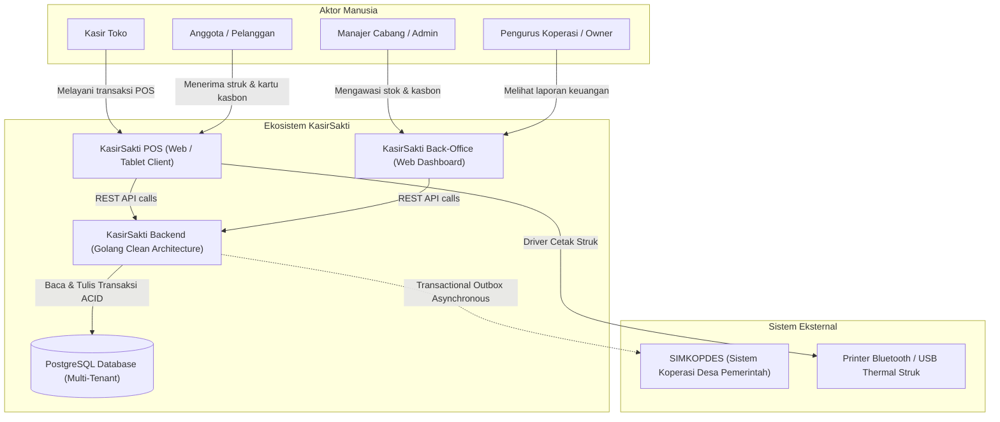

# 🌐 System Context (C4 Model) — KasirSakti Platform

Dokumen ini memetakan batasan sistem (*system boundary*), aktor manusia, antarmuka klien, dan sistem eksternal yang berinteraksi dengan KasirSakti.

---

## Diagram Konteks Sistem (C4 Context Level 1)

---

## Batasan & Tanggung Jawab Komponen
1. **KasirSakti Backend (`kasirsakti-be`)**:
   - Inti logika bisnis, otentikasi JWT, penegakan RBAC, multi-tenant partitioning, dan ACID transaction manager.
2. **PostgreSQL Database**:
   - Penyimpanan relasional dengan pemisahan tenant via `merchant_id` pada setiap tabel bisnis.
3. **SIMKOPDES**:
   - Pihak ketiga eksternal yang dihubungi secara asinkron; downtime pada SIMKOPDES tidak boleh menghambat operasional offline/online checkout POS lokal.
