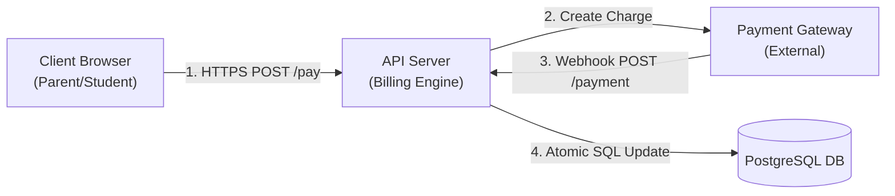

# STRIDE Threat Model: School Payment & Settlement

## 1. Data Flow Diagram (DFD)

## 2. STRIDE Assessment Matrix

| Element | Threat Type | Threat Scenario | Impact | Mitigation Implemented | Verification Test |
| :--- | :--- | :--- | :--- | :--- | :--- |
| **Webhook Endpoint** | Spoofing | Attacker sends mock HTTP POST to `/api/webhooks/payment` to mark bills paid without transferring money. | Critical: Financial loss | Strict constant-time HMAC-SHA256 signature verification with pre-shared secret key. | Automated Security Test: `tests/security/webhook-signature.spec.ts` |
| **Charge API** | Tampering | Student alters `amount` in JSON payload to pay Rp 100 instead of Rp 500,000. | High: Underpayment | The server ignores client-supplied amounts; amount is computed strictly server-side from database bill records. | Unit Test: `tests/billing/create-charge.spec.ts` |
| **Audit Logs** | Repudiation | Parent claims they never initiated payment or TU staff denies receiving notice. | Medium: Dispute | Append-only transaction log storing client IP, user agent, transaction ID, and timestamp. | Audit Log Verification |
| **Bills Query** | Information Disclosure | Student changes `student_id` in URL parameter to view unpaid bills of classmates (IDOR). | High: Privacy breach | RBAC middleware checks `req.user.student_id === params.studentId` or `req.user.role === 'ADMIN'`. | Auth Integration Test: `tests/api/idor-prevention.spec.ts` |
| **Payment Creation** | Denial of Service | Malicious actor runs script to generate 50,000 QRIS charges, exceeding gateway quotas. | High: Service outage | Redis sliding-window rate limiter restricted to 10 charges per user per 5 minutes. | k6 Rate Limit Test |
| **Refunds** | Elevation of Privilege | Student calls `/api/admin/bills/:id/refund` using student JWT token. | Critical: Unauthorized fund drain | Explicit role validation requiring `SUPERADMIN` role; student token rejected with 403 Forbidden. | RBAC Automated Test |
